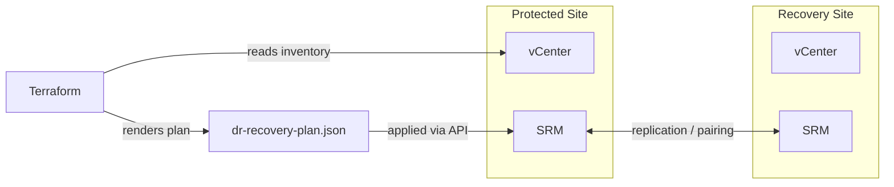

# VMware DR Automation

[](LICENSE)
[](https://github.com/abhisheksawant52/vmware-dr-automation/actions/workflows/ci.yml)
[](https://www.terraform.io/)

Infrastructure-as-Code for automating **VMware Site Recovery Manager (SRM)** and
**vSphere Replication** disaster-recovery: protection groups, recovery plans,
RPO targets, and VM boot-order tiers — defined declaratively and version
controlled.

## Overview

SRM is operated through its own API rather than a native Terraform provider.
This project keeps DR definitions as code: protection groups and recovery plans
are Terraform variables that render a versioned `dr-recovery-plan.json`, which
your operator tooling or CI applies against SRM / vSphere Replication. The
vSphere provider validates the protected datacenter inventory.

## Architecture



## Features

- **Protection groups** with array-based or vSphere Replication and RPO targets.
- **Recovery plans** composing protection groups with prioritized boot tiers.
- Modular Terraform with `dev` and `prod` environments and remote-state config.
- CI: `terraform fmt`, `validate`, and `tflint`.

## Tech Stack

Terraform >= 1.5 · hashicorp/vsphere · hashicorp/local · GitHub Actions

## Getting Started

```bash
cp terraform.tfvars.example terraform.tfvars   # edit values
make init
make plan
terraform apply
```

## Project Structure

```
.
├── main.tf / variables.tf / outputs.tf / providers.tf / versions.tf
├── modules/recovery-plan/     # renders the DR recovery plan
├── environments/{dev,prod}/   # per-env tfvars + backend config
├── docs/usage.md
└── .github/workflows/ci.yml
```

## Configuration

| Variable               | Description                                  |
| ---------------------- | -------------------------------------------- |
| `vsphere_server`       | Protected-site vCenter FQDN/IP               |
| `recovery_site`        | Recovery vCenter + SRM URLs                   |
| `protection_groups`    | Replicated VM groups and RPO                  |
| `recovery_plans`       | Ordered failover plans with boot tiers        |

## Deployment

See [docs/usage.md](docs/usage.md) for the full workflow and failover testing.

## Contributing

See [CONTRIBUTING.md](CONTRIBUTING.md) and the [Code of Conduct](CODE_OF_CONDUCT.md).

## Security

Report vulnerabilities per [SECURITY.md](SECURITY.md).

## License

[MIT](LICENSE).
